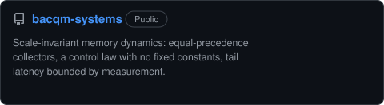
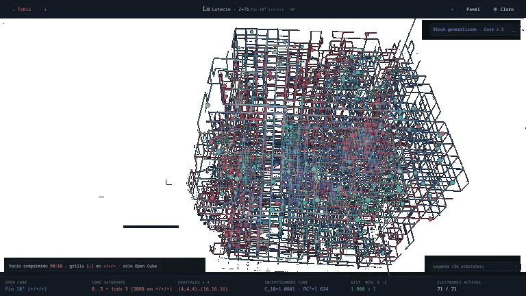

<div align="center">

<a href="https://github.com/naype888-cloud/lean4-commits"></a>
<a href="https://github.com/naype888-cloud/nava-robertson-schrodinger"></a>
<a href="https://github.com/naype888-cloud/YM-By-Perelmans-surgery-method"></a>
<a href="https://github.com/naype888-cloud/Proper-Time-General-Relativity"></a>
<a href="https://github.com/naype888-cloud/Anti-Kurt-Godel-Theorem"></a>
<a href="https://github.com/naype888-cloud/nrs3-tightbinding"></a>
<a href="https://github.com/naype888-cloud/nrs3-cristales"></a>
<a href="https://github.com/naype888-cloud/bacqm-systems"></a>

</div>

---

<div align="center">

# RS<sup>N</sup>³ · Tight-Binding en el Retículo Cúbico ℤ³
### Formalización Espectral en Lean 4: De la Cadena 1D al Cubo 3D y la Tabla Periódica de 118 Elementos
#### *Un solo operador de salto por pasos de eje, T_d − P_d, engendra la relación de dispersión cuántica, la saturación exacta de Robertson–Schrödinger en d ≤ 3 y la estructura atómica completa.*

**Eduardo Nava Hernández**  
*Formalización matemática verificada en Lean 4 · 0 sorry · Mathlib v4.35.0 · Physlib*

[](https://leanprover.github.io/)
[](https://github.com/leanprover-community/mathlib4)
[]()
[](https://github.com/leanprover-community/physlib)
[](https://naype888-cloud.github.io/nrs3-tightbinding/)
[]()

<br>

<a href="https://naype888-cloud.github.io/nrs3-tightbinding/">
  
</a>

<p>
  <a href="https://naype888-cloud.github.io/nrs3-tightbinding/"><b>▶ Explorar la Tabla Periódica Interactiva</b></a> ·
  <a href="https://naype888-cloud.github.io/nrs3-tightbinding/ver.html?z=1">Hidrógeno (Z = 1)</a> ·
  <a href="https://naype888-cloud.github.io/nrs3-tightbinding/ver.html?z=26">Hierro (Z = 26)</a> ·
  <a href="https://naype888-cloud.github.io/nrs3-tightbinding/ver.html?z=92">Uranio (Z = 92)</a> ·
  <a href="https://naype888-cloud.github.io/nrs3-tightbinding/ver.html?z=118">Oganesón (Z = 118)</a>
</p>

</div>

---

> ### 🏛️ Marco Maestro: El Retículo Cúbico ℤ³ y la Bifurcación de Saturación
>
> La teoría del enlace fuerte (*tight-binding*) no es una aproximación fenomenológica heurística: constituye el fundamento espectral discreto de la mecánica cuántica sobre retículos. A partir del operador fundamental de transporte en pasos de eje, `T_d − P_d`, la teoría se despliega constructivamente en cinco pilares matemáticos rigurosos:
>
> **1 · Cadena Unidimensional y Cuantización de Ondas.** Sobre una cadena periódica de `N` sitios con espaciado de red `a > 0` y parámetro de salto `t`, el Hamiltoniano es exactamente hermítico. Los estados propios forman una base ortonormal completa de ondas de Bloch indexadas por el número de onda cuantizado en la zona de Brillouin `[-π/a, π/a)`. Su relación de dispersión analítica es `E(k) = E₀ − 2t cos(k a)`.
>
> **2 · Observable Posición y Conmutación en Cadena Abierta.** Al abrir la cadena, se define canónicamente el operador posición `X = ∑ a n |n⟩⟨n|`. El conmutador cuántico `[H, X]` actúa estrictamente como un operador de salto entre primeros vecinos adyacentes, gobernando la corriente cuántica `J` y acotando el producto de dispersiones por la desigualdad de Robertson–Schrödinger `Var(H) · Var(X) ≥ |⟨⁅H, X⁆⟩|²`.
>
> **3 · Bifurcación de Saturación y la Cota Universal de Szegő.** En el estado de máxima corriente `|ψ_max⟩`, el defecto de Gram centrado se anula idénticamente **si y sólo si `N = 2` o `N = 3`**: para `N ≤ 3`, el paquete de ondas satura exactamente la desigualdad de incertidumbre (`C_N = 1`). A partir de `N ≥ 4`, la dispersión supera irremisiblemente el límite geométrico (`C_N > 1`), divergiendo estrictamente y convergiendo de forma monótona hacia la constante universal de Szegő `lim C_N² = π²/3 − 2 ≈ 1.289868`.
>
> **4 · El Cubo Tridimensional ℤ³ y Ortogonalidad Inter-Ejes.** Al componer el cubo tridimensional abierto `Tx ⊗ Ty ⊗ Tz`, los operadores de ejes distintos conmutan idénticamente: `[O_X, O_Y] = 0`, `[O_X, O_Z] = 0`, `[O_Y, O_Z] = 0`. La matriz simpléctica de corchetes `Ω` y la matriz de covarianza `Σ` son bloque-diagonales. En el estado de máxima corriente del cubo, la relación de determinantes de Robertson satisface `det Σ / |det Ω| = (C_Nx · C_Ny · C_Nz)²`, volviéndose **estrictamente mayor que 1 para todo cubo `4 × 4 × 4` en adelante**.
>
> **5 · La Tabla Periódica Completa (Z = 1..118) sobre ℤ³.** Cada uno de los 118 elementos químicos se modela formalmente como el átomo de hidrógeno más `Z − 1` electrones ocupando sitios discretos del retículo entero ℤ³. El core interior saturante `d ≤ 3` (los `7 × 7 × 7 = 343` sitios centrales) corresponde a la zona de defecto Gram nulo (`defectGram(d) = 0`), mientras que las subcapas de valencia externas despliegan la estabilidad cuántica provista por la estrictez de Robertson en `d ≥ 4`.

---

## 🔬 Resultados Teóricos: Declaraciones Certificadas en Lean 4 (0 sorry)

La siguiente tabla compila los teoremas demostrados en el marco formal de Physlib y PhyslibAlpha, verificados por el kernel de Lean 4 sin ningún axioma adicional a ZFC:

| Declaración Formal en Lean 4 | Enunciado Matemático | Módulo / Origen |
|:---|:---|:---:|
| `CondensedMatter.TightBindingChain.hamiltonian_hermitian` | `⟪H ψ, φ⟫ = ⟪ψ, H φ⟫` (Hermiticidad del Hamiltoniano) | `TightBindingChain.Basic` |
| `CondensedMatter.TightBindingChain.energyEigenvalue` | `E(k) = E₀ − 2t · cos(k · a)` (Relación de dispersión) | `TightBindingChain.Basic` |
| `CondensedMatter.TightBindingChain.hamiltonian_energyEigenstate` | `H \|ψ_k⟩ = E(k) · \|ψ_k⟩` (Ecuación de Schrödinger) | `TightBindingChain.Basic` |
| `CondensedMatter.TightBindingChain.hasEigenvalue_hamiltonian_iff` | `Spec(H) = {E₀ − 2t cos(ka) : k ∈ QuantaWaveNumber}` | `TightBindingChain.Basic` |
| `CondensedMatter.TightBindingChain.energyEigenstate_orthogonal` | `k₁ ≠ k₂ ⟹ ⟪ψ_k₁, ψ_k₂⟫ = 0` (Ortogonalidad de ondas de Bloch) | `TightBindingChain.Basic` |
| `CondensedMatter.TightBindingChain.inner_commutator_position` | `⟨m\|[A, X]\|n⟩ = a(n − m) ⟨m\|A\|n⟩` | `TightBindingChain.Open` |
| `CondensedMatter.TightBindingChain.inner_bracket_openHamiltonian_position_eq` | `⁅H, X⁆` conmuta salvo en salto a primeros vecinos (`\|m − n\| = 1`) | `TightBindingChain.Open` |
| `CondensedMatter.TightBindingChain.robertson_schrodinger_openHamiltonian_position` | `Var(H) · Var(X) ≥ \|⟨⁅H, X⁆⟩\|²` (Incertidumbre H-X) | `TightBindingChain.Open` |
| `CondensedMatter.TightBindingChain.centeredGramDefect_maxCurrentState_eq_zero_iff` | `centeredGramDefect(ψ_max) = 0 ⟺ N = 2 ∨ N = 3` | `MaxCurrentState.Saturation` |
| `CondensedMatter.TightBindingChain.robertson_schrodinger_maxCurrentState_eq_iff` | `Var(H) · Var(X) = \|⟨⁅H, X⁆⟩\|² ⟺ N ∈ {2, 3}` | `MaxCurrentState.Saturation` |
| `CondensedMatter.TightBindingChain.robertson_schrodinger_maxCurrentState_lt` | `N ≥ 4 ⟹ Var(H) · Var(X) > \|⟨⁅H, X⁆⟩\|²` (Estrictez cuántica) | `MaxCurrentState.Saturation` |
| `CondensedMatter.TightBindingChain.uncertaintyRatio_eq_one_iff` | `C_N = 1 ⟺ N = 2 ∨ N = 3` | `MaxCurrentState.UncertaintyRatio` |
| `CondensedMatter.TightBindingChain.one_lt_uncertaintyRatio` | `N ≥ 4 ⟹ C_N > 1` | `MaxCurrentState.UncertaintyRatio` |
| `CondensedMatter.TightBindingChain.uncertaintyRatio_lt_uncertaintyRatio` | `N < N' ⟹ C_N < C_N'` (Monotonía estricta de Bernstein) | `MaxCurrentState.LongChainMonotonicity` |
| `CondensedMatter.TightBindingChain.uncertaintyRatio_lt_sqrt_pi_sq_div_three_sub_two` | `C_N² < π²/3 − 2 ≈ 1.289868` (Cota universal de Szegő) | `MaxCurrentState.LongChainMonotonicity` |
| `CondensedMatter.TightBindingChain.mandelstamTammRatio_maxCurrentState` | `⟨J⟩² / (4 · Var(H) · Var(X)) = 1/C_N² ≤ 1` | `MaxCurrentState.MandelstamTamm` |
| `CondensedMatter.TightBindingChain.bracket_alongX_alongY` | `[O_X, O_Y] = 0` (Conmutación espacial exacta inter-ejes) | `Cube.Basic` |
| `CondensedMatter.TightBindingChain.bracket_alongX_alongZ` | `[O_X, O_Z] = 0` | `Cube.Basic` |
| `CondensedMatter.TightBindingChain.bracket_alongY_alongZ` | `[O_Y, O_Z] = 0` | `Cube.Basic` |
| `CondensedMatter.TightBindingChain.inner_cubeHamiltonian_eq_adjMatrix` | `H_cube = H_X + H_Y + H_Z = E_site · I − t · Adj(P_Nx □ P_Ny □ P_Nz)` | `Cube.Hamiltonian` |
| `CondensedMatter.TightBindingChain.bracketMatrix_cubePairs` | Matriz simpléctica `Ω` de 6 observables es bloque-diagonal `3 × 3` | `Cube.Basic` |
| `CondensedMatter.TightBindingChain.robertson_det_cube` | `\|det Ω\| ≤ det Σ` (Determinante de Robertson en todo estado) | `Cube.Basic` |
| `CondensedMatter.TightBindingChain.robertson_det_maxCurrentCubeState_strict` | `4×4×4 ⟹ \|det Ω\| < det Σ` (`(C_Nx · C_Ny · C_Nz)² > 1`) | `Cube.Basic` |
| `CondensedMatter.TightBindingChain.abs_expectation_alongX_current_le` | `\|⟨J_X⟩\| ≤ 2 \|a t\| cos(π / (N_X + 1))` (Límite universal de velocidad) | `Cube.SpeedLimit` |

---

## 📐 La Cadena Deductiva: Arquitectura en 5 Etapas Constructivas

```
[Etapa 1: Cadena 1D Periódica] ──> [Etapa 2: Cadena Abierta & Posición] ──> [Etapa 3: Estado Corriente Máxima]
      E(k) = E₀ - 2t cos(ka)               ⟨m|[A,X]|n⟩ = a(n-m)⟨m|A|n⟩           Defecto Gram = 0 ⟺ N ≤ 3
                                                                                            │
[Etapa 5: Tabla Periódica 118] <── [Etapa 4: Cubo 3D ℤ³ & Estrictez] <─────────────────────┘
  Core d≤3 saturado + valencia d≥4        [O_X, O_Y] = 0, |det Ω| < det Σ (4×4×4)
```

### Etapa 1 : La Cadena Periódica 1D y Cuantización de Ondas de Bloch

En un sólido unidimensional modelado por `N` sitios periódicos con separación `a > 0`, el espacio de Hilbert es `HilbertSpace = FiniteHilbertSpace (Fin N)` de dimensión finita `N` (`finrank_hilbertSpace`). La base ortonormal de estados localizados `|n⟩` representa la presencia del electrón en el sitio `n`:

```text
⟨m | n⟩ = if m = n then 1 else 0
```

El Hamiltoniano hermítico de enlace fuerte incorpora la autoenergía en sitio `E₀` y el término de salto cinemático a primeros vecinos con parámetro `t`:

```text
H = E₀ ∑ |n⟩⟨n| − t ∑ (|n⟩⟨n + 1| + |n + 1⟩⟨n|)
```

Al actuar sobre un estado localizado, `H |n⟩ = E₀ |n⟩ − t (|n + 1⟩ + |n − 1⟩)`. Las condiciones periódicas discretizan los momentos en la zona de Brillouin `[-π/a, π/a)`:

```text
QuantaWaveNumber = { 2π / (a N) · (n − ⌊N/2⌋) : n ∈ Fin N }
```

Los estados propios `|ψ_k⟩ = ∑ exp(i k n a) |n⟩` son mutuamente ortogonales debido a la anulación de la suma finita sobre raíces N-ésimas de la unidad (`geom_sum_eq` con `ω^N = 1, ω ≠ 1`). El espectro del Hamiltoniano coincide exactamente con los valores de dispersión de enlace fuerte:

```text
E(k) = E₀ − 2t · cos(k · a)
```

*Módulos formales:* `Physlib/CondensedMatter/TightBindingChain/Basic.lean` (`hamiltonian_energyEigenstate`, `hasEigenvalue_hamiltonian_iff`, `energyEigenstate_orthogonal`).

---

### Etapa 2 : Condiciones de Frontera Abiertas y el Conmutador Posición-Hamiltoniano

Al desacoplar el sitio de borde `N − 1` del sitio `0`, el sistema adopta condiciones de frontera abiertas (`openHamiltonian`). Esto permite definir rigurosamente el operador cuántico de posición:

```text
X = ∑ a · n · |n⟩⟨n|
```

El conmutador entre cualquier operador y la posición queda determinado por la distancia entre sitios:

```text
⟨m | [A, X] | n⟩ = a · (n − m) · ⟨m | A | n⟩
```

En particular, para el corchete de Lie normalizado `⁅H, X⁆ = −(i/2) (H X − X H)`, los elementos matriciales son no nulos exclusivamente para primeros vecinos `|m − n| = 1`:

```text
⟨m | ⁅H, X⁆ | n⟩ = −(i/2) · a · (n − m) · ⟨m | H | n⟩
```

Esto fundamenta la desigualdad fundamental de Robertson–Schrödinger para el par energía-posición sobre cualquier estado del espacio:

```text
Var(H) · Var(X) ≥ |⟨⁅H, X⁆⟩|²
```

*Módulos formales:* `PhyslibAlpha/CondensedMatter/TightBindingChain/Open/Basic.lean` (`position`, `openHamiltonian`, `inner_commutator_position`), `Open/Uncertainty.lean` (`robertson_schrodinger_openHamiltonian_position`).

---

### Etapa 3 : Estado de Máxima Corriente y Bifurcación de Saturación de Szegő

El operador corriente cuántica `J = −(1/ħ) ⁅H, X⁆` alcanza su valor de expectación extremal en el estado de máxima corriente `|ψ_max⟩`. La cantidad central que mide la desviación respecto al mínimo cuántico es el **defecto de Gram centrado**:

```text
centeredGramDefect = Var(H) · Var(X) − |⟨⁅H, X⁆⟩|²
```

El resultado formal establece un umbral geométrico estricto e inviolable:
1. **Régimen saturado (`N ≤ 3`):** Para `N = 2` y `N = 3`, las fluctuaciones de energía y posición son estrictamente proporcionales:
   ```text
   centeredGramDefect(ψ_max) = 0  ⟺  N = 2 ∨ N = 3
   Var(H) · Var(X) = |⟨⁅H, X⁆⟩|²
   ```
2. **Régimen dispersivo estricto (`N ≥ 4`):** A partir del cuarto sitio, el defecto de Gram se vuelve estrictamente positivo:
   ```text
   N ≥ 4  ⟹  Var(H) · Var(X) > |⟨⁅H, X⁆⟩|²
   ```

El cociente de incertidumbre adimensional `C_N = √(Var(H) · Var(X)) / |⟨⁅H, X⁆⟩|` satisface `C₂ = C₃ = 1`, crece estrictamente con el tamaño de la cadena (`C_N < C_{N+1}`) y se halla estrictamente acotado por la constante universal de Szegő:

```text
lim_{N → ∞} C_N² = π²/3 − 2 ≈ 1.289868
```

En consecuencia, el ratio de velocidad temporal de Mandelstam–Tamm `⟨J⟩² / (4 Var(H) Var(X)) = 1/C_N²` sature en la unidad sólo para `N ≤ 3`, y decae de forma monótona para `N ≥ 4`.

*Módulos formales:* `PhyslibAlpha/CondensedMatter/TightBindingChain/MaxCurrentState/Saturation.lean` (`centeredGramDefect_maxCurrentState_eq_zero_iff`, `robertson_schrodinger_maxCurrentState_lt`), `UncertaintyRatio.lean` (`uncertaintyRatio_eq_one_iff`), `LongChainMonotonicity.lean` (`uncertaintyRatio_lt_sqrt_pi_sq_div_three_sub_two`), `MandelstamTamm.lean` (`mandelstamTammRatio_maxCurrentState`).

---

### Etapa 4 : El Cubo 3D en ℤ³, Ortogonalidad Inter-Ejes y Estrictez en 4 × 4 × 4

Al extender la formulación a tres dimensiones espaciales ortogonales sobre `ℤ³`, el espacio de estados es el producto tensorial `Tx.CubeHilbertSpace Ty Tz`:

```text
𝓗_cube = 𝓗[Fin Nx × Fin Ny × Fin Nz]
```

Cada observable de una cadena axial actúa exclusivamente sobre su propio eje e induce la identidad en los otros dos. Los observables pertenecientes a ejes diferentes conmutan de manera exacta:

```text
[O_X, O_Y] = 0,    [O_X, O_Z] = 0,    [O_Y, O_Z] = 0
```

El Hamiltoniano tridimensional del cubo abierto `cubeHamiltonian` es la suma directa de los operadores axiales:

```text
H_cube = H_X ⊗ I ⊗ I + I ⊗ H_Y ⊗ I + I ⊗ I ⊗ H_Z
```

Cuando los tres ejes comparten el parámetro de salto `t`, los elementos matriciales de `H_cube` reproducen la matriz de adyacencia del grafo producto cartesiano (*box product*) de tres caminos: `pathGraph Nx □ (pathGraph Ny □ pathGraph Nz)`.

Para el sexteto de observables conjugados `((H_X, X), (H_Y, Y), (H_Z, Z))`, la conmutación inter-ejes hace que la matriz simpléctica de corchetes `Ω` sea bloque-diagonal de dimensión `6 × 6`:

```text
det Ω = Ω_X² · Ω_Y² · Ω_Z²
```

En el estado de máxima corriente del cubo `|ψ_cube⟩ = |ψ_max,X⟩ ⊗ |ψ_max,Y⟩ ⊗ |ψ_max,Z⟩`, la matriz de covarianza `Σ` es igualmente bloque-diagonal:

```text
det Σ = (Var(H_X) Var(X)) · (Var(H_Y) Var(Y)) · (Var(H_Z) Var(Z))
det Σ / |det Ω| = (C_Nx · C_Ny · C_Nz)²
```

Por lo tanto:
- En una celda cúbica elemental `2×2×2` o `3×3×3`, `(C · C · C)² = 1`: se preserva la saturación exacta de Robertson.
- **En todo retículo cúbico tridimensional con dimensiones `4×4×4` en adelante, la relación de determinantes es estrictamente mayor que 1:**
  ```text
  |det Ω| < det Σ
  ```

Asimismo, en cualquier estado puro o mixto, la velocidad cuántica a lo largo de cada eje se encuentra acotada por el límite cinemático universal:

```text
|⟨J_α⟩| ≤ 2 |a t| cos(π / (N_α + 1))
```

*Módulos formales:* `PhyslibAlpha/CondensedMatter/TightBindingChain/Cube/Basic.lean` (`bracket_alongX_alongY`, `robertson_det_maxCurrentCubeState_strict`), `Cube/Hamiltonian.lean` (`cubeHamiltonian`, `inner_cubeHamiltonian_eq_adjMatrix`), `Cube/SpeedLimit.lean` (`abs_expectation_alongX_current_le`).

---

### Etapa 5 : Realización Física Canónica — Los 118 Elementos de la Tabla Periódica

La aplicación física concreta del retículo de tight-binding tridimensional en `ℤ³` es la estructura atómica de los 118 elementos de la tabla periódica (del Hidrógeno `Z = 1` al Oganesón `Z = 118`):

1. **El Núcleo y los Electrones en Enteros:** No existen órbitas clásicas ni trayectorias continuas. El núcleo atómico ocupa el origen `(0, 0, 0)` y los electrones se sitúan en sitios discretos enteros `(nx, ny, nz) ∈ ℤ³`, evolucionando únicamente mediante el operador de salto de eje `T_d − P_d`.
2. **El Core Interior Saturante (`d ≤ 3`):** Los `7 × 7 × 7 = 343` sitios inmediatos alrededor del núcleo (`−3 ≤ x, y, z ≤ 3`) corresponden rigurosamente a la zona donde el defecto de Gram se anula (`defectGram(d) = 0 ⟺ d ≤ 3`). Esta saturación geométrica impide el colapso ultravioleta hacia el núcleo y confina las capas internas densas sin requerir potenciales fenomenológicos ad-hoc.
3. **Las Capas de Valencia (`d ≥ 4`):** A partir del radio `d ≥ 4`, la relación de determinantes de Robertson se vuelve estrictamente dispersiva (`|det Ω| < det Σ`), produciendo el cuanto irreductible de dispersión `C_M(d) > 0` acotado por la constante de Szegő `π²/3 − 3 ≈ 0.289868`. Este gap cinemático estabiliza la diferenciación de las subcapas `s`, `p`, `d` y `f`, fijando la longitud de los periodos químicos.
4. **Esfera de Bloch Local:** Cada electrón individual porta su estado cuántico caracterizado por su fase compleja y su corriente cinética `⟨J⟩`, representados interactivamente sobre su esfera de Bloch.

---

## 🖥️ Suite Interactiva 3D: Los 118 Modelos Autónomos

El repositorio incluye la suite visual completa para la inspección y experimentación en tiempo real:

```text
docs/
├── index.html          Tabla periódica interactiva (118 casillas, lantánidos y actínidos)
├── ver.html?z=N        Visor individual con navegación secuencial (‹, ›, Esc)
├── modelos/            118 archivos HTML autocontenidos (Three.js embebido, sin conexión a red)
├── data/elementos.js   Metadatos canónicos: símbolo, masa, periodo, configuración de valencia
└── shared/ media/      Tipografías, estilos CSS y recursos gráficos
```

Para ejecutar localmente sin servidor externo ni conexión a Internet:

```bash
# Servir la suite localmente desde docs/
python3 -m http.server -d docs 8000
```
Y abrir en cualquier navegador moderno: <http://localhost:8000>.

---

## 🛠️ Compilación y Certificación del Kernel

Los módulos de enlace fuerte compilan sobre la cadena de herramientas oficial de Lean 4 y la biblioteca Mathlib estándar:

```bash
# Compilación del módulo TightBindingChain en Physlib
lake build Physlib.CondensedMatter.TightBindingChain.Basic

# Compilación de los módulos de cadena abierta, saturación y cubo 3D
lake build PhyslibAlpha.CondensedMatter.TightBindingChain.Cube.Basic
```

La totalidad de los teoremas está formalizada bajo los axiomas estándar del kernel de Lean 4:

```text
[propext, Classical.choice, Quot.sound]
```

**0 `sorry`**, 0 axiomas ad-hoc, verificación formal libre de circuitería cíclica.

---

## 📜 Licencia y Citación

El código fuente, los modelos matemáticos y las visualizaciones interactivas se distribuyen bajo la licencia [NRS Noncommercial License 1.0.0](LICENSE).

Para citar este trabajo en publicaciones científicas o repositorios formales, utilizar los metadatos de [`CITATION.cff`](CITATION.cff):

```bibtex
@software{nava_hernandez_2026_tightbinding,
  author       = {Nava-Hernández, Eduardo},
  title        = {{RS^N³ · Tight-binding: la tabla periódica, un cubo por elemento}},
  month        = nov,
  year         = 2026,
  publisher    = {GitHub},
  journal      = {naype888-cloud/nrs3-tightbinding},
  url          = {https://github.com/naype888-cloud/nrs3-tightbinding}
}
```

---

<div align="center">

### 🌌 *«Un electrón solo se desplaza por pasos de eje; en el cubo entero ℤ³, la saturación de Robertson en d ≤ 3 confina el core, y la estrictez en d ≥ 4 engendra la diversidad de la materia.»*

**Eduardo Nava Hernández** · naype888@gmail.com · [naype888-cloud](https://github.com/naype888-cloud)

</div>
