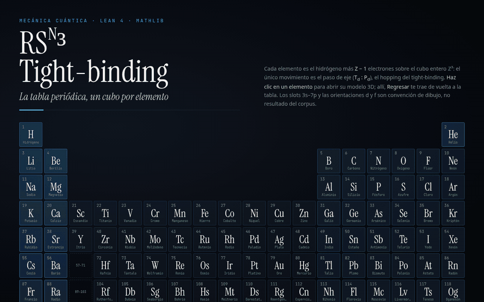

<div align="center">

# RS<sup>N</sup>³ · Tight-binding

**La tabla periódica, un cubo por elemento.**

<a href="https://naype888-cloud.github.io/nrs3-tightbinding/">
  
</a>

<p>
  <a href="https://naype888-cloud.github.io/nrs3-tightbinding/"><b>▶ Abrir la tabla</b></a> ·
  <a href="https://naype888-cloud.github.io/nrs3-tightbinding/ver.html?z=26">Ver el hierro</a> ·
  <a href="https://naype888-cloud.github.io/nrs3-tightbinding/ver.html?z=92">Ver el uranio</a>
</p>


</div>

---

## Qué es

Cada uno de los 118 elementos, de **H** a **Og**, dibujado como el hidrógeno más `Z − 1` electrones sobre el
**cubo entero ℤ³**. Un electrón solo se mueve por pasos de eje, el *hopping* del tight-binding
(`T_d : P_d`). No hay trayectorias continuas: hay sitios enteros, una caja finita y un núcleo en el centro.

Haz clic en un elemento y se abre su modelo 3D. **← Regresar** (o `Esc`) vuelve a la tabla; **‹ ›** salta al
elemento anterior o siguiente.

## Cómo leer un modelo

| Lo que ves | Qué significa |
|---|---|
| **Caja** `n×n×n` | La red de sitios enteros donde pueden estar los electrones. Crece con Z. |
| **Core dorado** | La zona saturante `d ≤ 3`: 343 sitios (`7×7×7`) alrededor del núcleo. |
| **Lóbulos de color** | Las subcapas s, p, d y f; cada capa externa se dibuja más grande. |
| **Esfera de Bloch** | El estado de un electrón elegido, con su fase y su corriente. |
| **Tarjeta del núcleo** | Isótopo de referencia (A, protones, neutrones): el más abundante, o el de vida más larga. |
| **Valencia** | Solo la capa externa; el resto es core (Fe: `4s² 3d⁶` sobre `[Ar]`). |

## Qué hay en el repo

```
docs/
├── index.html          la tabla (118 celdas; lantánidos y actínidos en filas aparte)
├── ver.html?z=N        visor: barra «Regresar» + el modelo del elemento N
├── modelos/            118 HTML autocontenidos (Three.js incluido, sin red)
├── data/elementos.js   símbolo, nombre, archivo y posición de cada Z
└── shared/ media/      estilos, fuentes e imágenes
```

Para verlo en local: `python3 -m http.server -d docs` y abre <http://localhost:8000>.

## De dónde salen los modelos

Una sola plantilla genera los 118 (`generar_cubo` → `canon_cuadrantes`). Cada archivo se **audita
regenerándolo y comparando byte a byte**, y además se abre en Chrome headless para buscar errores de
JavaScript: 118 de 118 pasan. Ningún HTML se edita a mano; si algo está mal se corrige el generador y se
regenera todo.

## Qué es convención y qué no

Los slots 3s–7p, la orientación de los orbitales d y f, las posiciones de los nucleones y la masa de los
elementos con Z ≥ 103 son **convención de dibujo**, no resultados formales. El marco matemático (el cubo
`RS^N³`, el paso de eje y el cierre en `d ≤ 3`) está en Lean 4 sobre Mathlib:

- [nrs3-hidrogeno](https://github.com/naype888-cloud/nrs3-hidrogeno) — el átomo en enteros
- [nrs3-cristales](https://github.com/naype888-cloud/nrs3-cristales) — redes y tight-binding
- [BACQM-NRS3](https://github.com/naype888-cloud/BACQM-NRS3) — la cadena formal completa

## Licencia y cita

[NRS Noncommercial License 1.0.0](LICENSE). Para citar este repositorio, GitHub ofrece **Cite this repository** en la barra
lateral (usa [`CITATION.cff`](CITATION.cff)).
