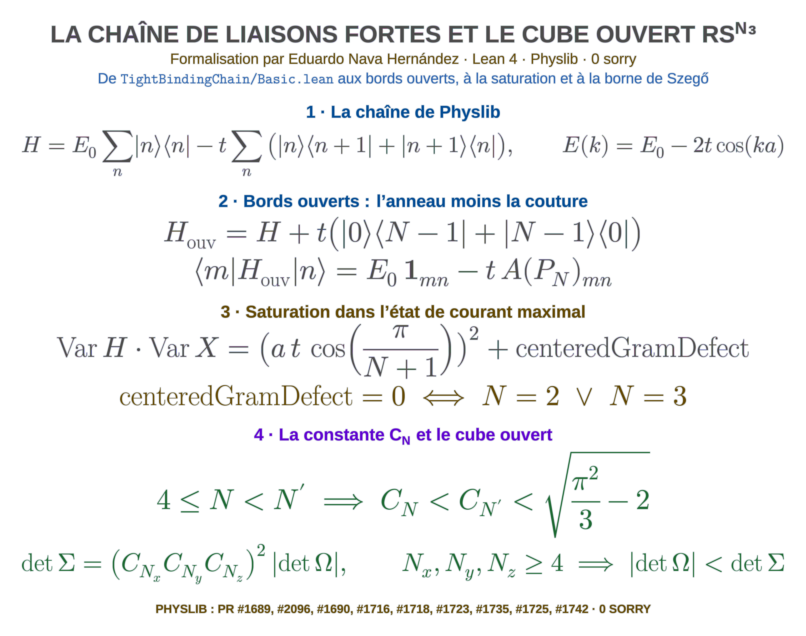
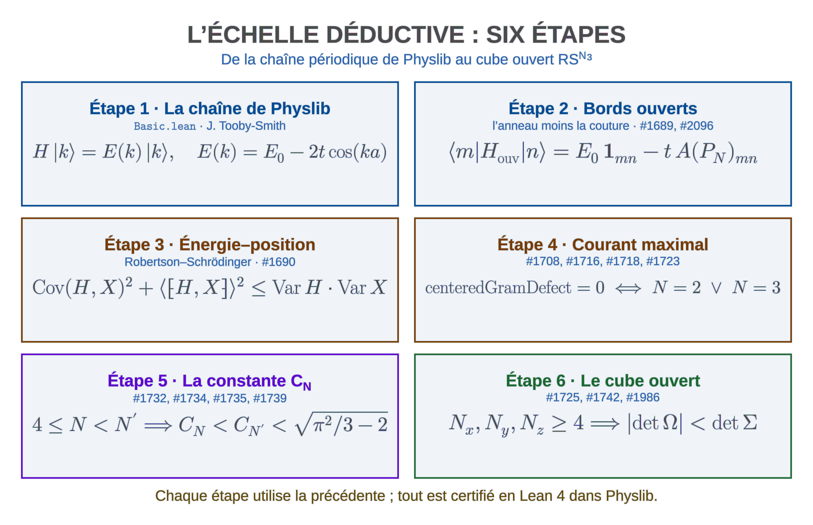
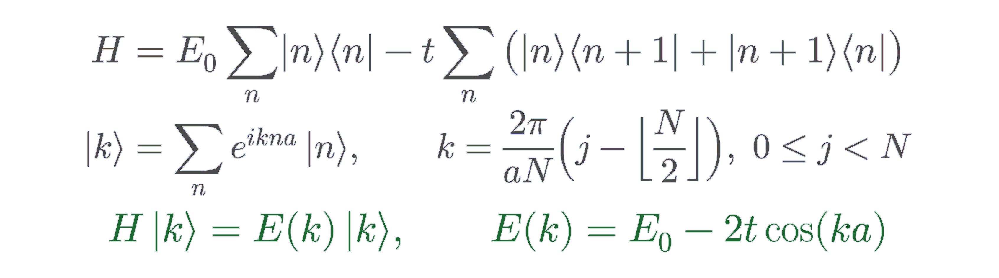
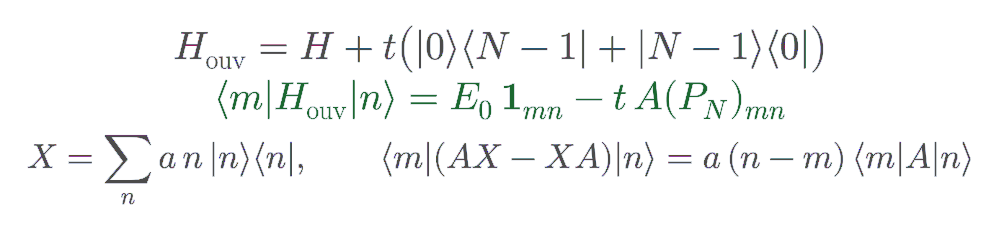
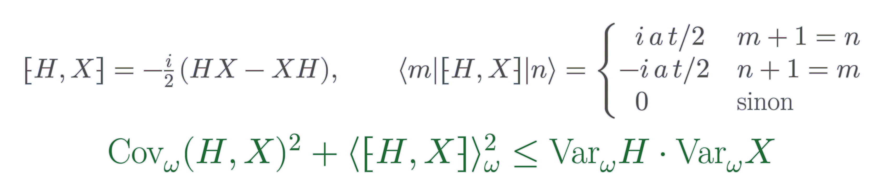
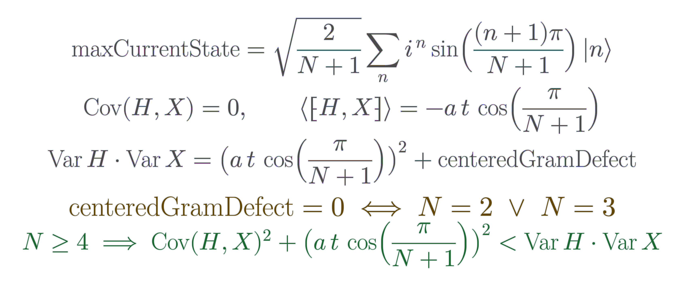
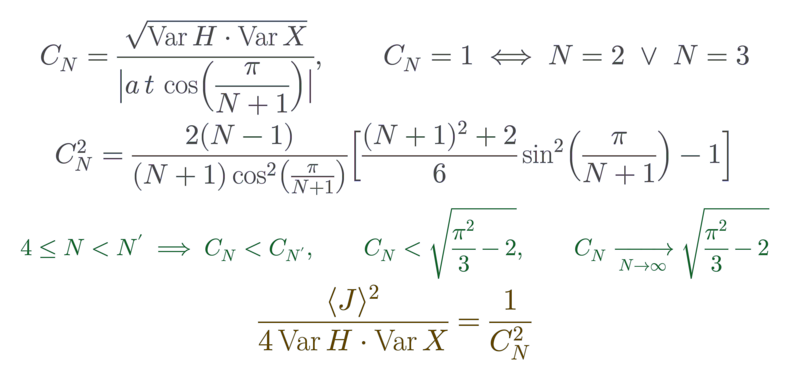
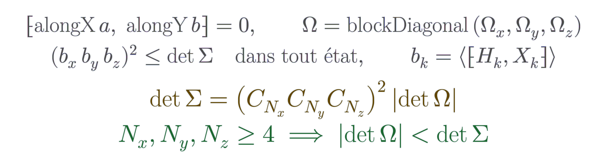

<div lang="fr">

<div align="center">

# RS<sup>N</sup>³ · La chaîne de liaisons fortes et le cube ouvert
### De la chaîne périodique de Physlib au cube ouvert : bords ouverts, saturation de Robertson–Schrödinger en N = 2, 3 et borne de Szegő — et la table périodique dessinée sur ℤ³

**Eduardo Nava Hernández**  
*Vérification formelle en Lean 4 · 0 sorry · Physlib (PhyslibAlpha)*

[](https://leanprover.github.io/)
[](https://github.com/leanprover-community/mathlib4)
[](https://github.com/leanprover-community/physlib/pulls?q=is%3Apr+is%3Amerged+author%3Anaype888-cloud)
[](https://github.com/leanprover-community/physlib/pulls?q=is%3Apr+is%3Amerged+author%3Anaype888-cloud)
[](https://naype888-cloud.github.io/nrs3-tightbinding/)

<br>

<a href="https://naype888-cloud.github.io/nrs3-tightbinding/">
  
</a>

<p>
  <a href="https://naype888-cloud.github.io/nrs3-tightbinding/"><b>▶ Ouvrir la table</b></a> ·
  <a href="https://naype888-cloud.github.io/nrs3-tightbinding/ver.html?z=1">Hydrogène (Z = 1)</a> ·
  <a href="https://naype888-cloud.github.io/nrs3-tightbinding/ver.html?z=26">Fer (Z = 26)</a> ·
  <a href="https://naype888-cloud.github.io/nrs3-tightbinding/ver.html?z=92">Uranium (Z = 92)</a> ·
  <a href="https://naype888-cloud.github.io/nrs3-tightbinding/ver.html?z=118">Oganesson (Z = 118)</a>
</p>

</div>

---

> ### 🏛️ Le module maître : de la chaîne de Physlib au cube ouvert
>
> La chaîne de liaisons fortes de Physlib (`TightBindingChain`, fichier `Basic.lean`) est un anneau de N sites. En retirant le seul lien de la couture, entre le site 0 et le site N − 1, on obtient la chaîne ouverte : c’est elle qui porte l’opérateur position et la relation énergie–position.
>
> <div align="center">
> <picture><source media="(prefers-color-scheme: dark)" srcset="assets/oscuro/plaque_tb_maitresse.png"></picture>
> </div>
>
> **1 · La chaîne de Physlib.** H a pour états propres les ondes planes |k⟩, d’énergie E(k) = E₀ − 2t cos(ka).
>
> **2 · Bords ouverts.** H_ouv = H + t(|0⟩⟨N−1| + |N−1⟩⟨0|) : l’anneau moins la couture, c’est-à-dire E₀ fois l’identité moins t fois la matrice d’adjacence du graphe chemin P_N.
>
> **3 · Saturation.** Dans l’état de courant maximal, la relation de Robertson–Schrödinger entre H et X est une égalité si et seulement si N = 2 ou N = 3 ; elle est stricte dès N ≥ 4.
>
> **4 · La constante C_N et le cube.** C_N est strictement croissante dès N ≥ 4 et reste sous √(π²/3 − 2) ; sur le cube ouvert, det Σ = (C_Nx · C_Ny · C_Nz)² · |det Ω|, strict dès 4 × 4 × 4.

---

## ⚡ Résumé formel

* **La chaîne.** [`Physlib/CondensedMatter/TightBindingChain/Basic.lean`](https://github.com/leanprover-community/physlib/blob/master/Physlib/CondensedMatter/TightBindingChain/Basic.lean) (Joseph Tooby-Smith) définit `TightBindingChain` (N sites, pas a, énergie de site E₀, saut t), la base orthonormée `localizedState`, le hamiltonien `hamiltonian`, la zone de Brillouin et les états propres : `hamiltonian_energyEigenstate` établit H |k⟩ = E(k) |k⟩ avec `energyEigenvalue` = E₀ − 2t cos(ka).
* **Le cristal périodique fini.** [`PhyslibAlpha/…/Bloch/TightBindingChain.lean`](https://github.com/leanprover-community/physlib/blob/master/PhyslibAlpha/CondensedMatter/Bloch/TightBindingChain.lean) : avec une orbitale par maille, `hoppingMatrix` vaut `E₀` sur le site et `−t` vers chacun des deux voisins, et `hopping_hoppingMatrix` montre que le hamiltonien de la chaîne est l'opérateur de saut du cristal périodique fini de Physlib (réseaux de Bravais).
* **Les bords ouverts.** [`PhyslibAlpha/…/Open/Basic.lean`](https://github.com/leanprover-community/physlib/blob/master/PhyslibAlpha/CondensedMatter/TightBindingChain/Open/Basic.lean) importe `Basic.lean` et définit `openHamiltonian` à partir de `T.hamiltonian` ; `inner_openHamiltonian_eq_adjMatrix` l’identifie au saut sur `SimpleGraph.pathGraph`. La position `position` et `inner_commutator_position` donnent ⟨m|(AX − XA)|n⟩ = a(n − m)⟨m|A|n⟩.
* **La relation énergie–position.** [`Open/Uncertainty.lean`](https://github.com/leanprover-community/physlib/blob/master/PhyslibAlpha/CondensedMatter/TightBindingChain/Open/Uncertainty.lean) : `inner_bracket_openHamiltonian_position_eq` (⁅H, X⁆ ne relie que des sites voisins) et `robertson_schrodinger_openHamiltonian_position` (Cov² + ⟨⁅H, X⁆⟩² ≤ Var H · Var X dans tout état).
* **La saturation.** [`MaxCurrentState/Saturation.lean`](https://github.com/leanprover-community/physlib/blob/master/PhyslibAlpha/CondensedMatter/TightBindingChain/MaxCurrentState/Saturation.lean) : `centeredGramDefect_maxCurrentState_eq_zero_iff` (égalité ⟺ N = 2 ∨ N = 3) et `robertson_schrodinger_maxCurrentState_lt` (stricte dès N ≥ 4).
* **La constante C_N.** `uncertaintyRatio` ; `uncertaintyRatio_eq_one_iff`, `uncertaintyRatio_sq_eq` (forme fermée), `uncertaintyRatio_lt_uncertaintyRatio` (croissance stricte), `uncertaintyRatio_lt_sqrt_pi_sq_div_three_sub_two` et `tendsto_uncertaintyRatio` (borne et limite de Szegő), `mandelstamTammRatio_maxCurrentState` (rapport de Mandelstam–Tamm = 1/C_N²).
* **Le cube ouvert.** [`Cube/Basic.lean`](https://github.com/leanprover-community/physlib/blob/master/PhyslibAlpha/CondensedMatter/TightBindingChain/Cube/Basic.lean) : `bracket_alongX_alongY`, `centeredGramDefect_alongX_eq_zero_iff`, `bracketMatrix_cubePairs`, `robertson_det_cube`, `det_covarianceMatrix_maxCurrentCubeState` et `robertson_det_maxCurrentCubeState_strict`.

---

## 📐 Chaîne déductive en six étapes

<div align="center">
<picture><source media="(prefers-color-scheme: dark)" srcset="assets/oscuro/plaque_tb_etapes.png"></picture>
</div>

### Étape 1 : La chaîne de liaisons fortes de Physlib

> **Proposition 1.1 (Ondes planes de l’anneau).** Sur la chaîne de N sites, où le site N est identifié au site 0, les états |k⟩ = ∑ₙ e^{ikna} |n⟩, de nombre d’onde quantifié k, sont propres pour H avec la valeur propre E(k) = E₀ − 2t cos(ka).

<div align="center"><picture><source media="(prefers-color-scheme: dark)" srcset="assets/oscuro/plaque_tb_etape1.png"></picture></div>

*Module formel :* [`Physlib/CondensedMatter/TightBindingChain/Basic.lean`](https://github.com/leanprover-community/physlib/blob/master/Physlib/CondensedMatter/TightBindingChain/Basic.lean) (`hamiltonian`, `energyEigenstate`, `energyEigenvalue`, `hamiltonian_energyEigenstate`). Auteur : Joseph Tooby-Smith. Toutes les étapes suivantes portent sur cette structure `TightBindingChain`.

> **Proposition 1.2 (La chaîne est un cristal périodique fini).** Avec une orbitale par maille, la matrice de saut vaut E₀ sur le site lui-même et −t vers chacun de ses deux voisins ; dans les coordonnées ⟨n|ψ⟩, le hamiltonien de la chaîne est l'opérateur de saut du cristal périodique fini défini par ces matrices. C'est le pont entre la chaîne de liaisons fortes et les réseaux cristallins de Physlib.

*Module formel :* [`PhyslibAlpha/CondensedMatter/Bloch/TightBindingChain.lean`](https://github.com/leanprover-community/physlib/blob/master/PhyslibAlpha/CondensedMatter/Bloch/TightBindingChain.lean) (`hoppingMatrix`, `hopping_hoppingMatrix`).  
*Physlib :* PR #2118.

---

### Étape 2 : Les bords ouverts — l’anneau moins la couture

> **Proposition 2.1 (Chaîne ouverte et graphe chemin).** Le hamiltonien ouvert est le hamiltonien périodique de l’étape 1 auquel on retire le saut entre les sites 0 et N − 1. Ses éléments de matrice sont E₀ fois l’identité moins t fois la matrice d’adjacence du graphe chemin P_N. L’opérateur position X = ∑ₙ a n |n⟩⟨n| vérifie ⟨m|(AX − XA)|n⟩ = a(n − m)⟨m|A|n⟩ pour tout opérateur A.

<div align="center"><picture><source media="(prefers-color-scheme: dark)" srcset="assets/oscuro/plaque_tb_etape2.png"></picture></div>

*Module formel :* [`PhyslibAlpha/CondensedMatter/TightBindingChain/Open/Basic.lean`](https://github.com/leanprover-community/physlib/blob/master/PhyslibAlpha/CondensedMatter/TightBindingChain/Open/Basic.lean) (`openHamiltonian`, `inner_openHamiltonian`, `inner_openHamiltonian_eq_adjMatrix`, `position`, `inner_commutator_position`). Démonstration : `inner_openHamiltonian` se lit sur `T.hamiltonian` de l’étape 1, puis on compare cas par cas avec l’adjacence de `SimpleGraph.pathGraph`.  
*Physlib :* PR #1689, PR #2096.

---

### Étape 3 : La relation énergie–position

> **Proposition 3.1 (Robertson–Schrödinger pour H et X).** Le crochet ⁅H, X⁆ = −(i/2)(HX − XH) ne relie que des sites voisins, avec les éléments de matrice ± i a t/2. Dans tout état ω, Cov(H, X)² + ⟨⁅H, X⁆⟩² ≤ Var H · Var X.

<div align="center"><picture><source media="(prefers-color-scheme: dark)" srcset="assets/oscuro/plaque_tb_etape3.png"></picture></div>

*Module formel :* [`PhyslibAlpha/CondensedMatter/TightBindingChain/Open/Uncertainty.lean`](https://github.com/leanprover-community/physlib/blob/master/PhyslibAlpha/CondensedMatter/TightBindingChain/Open/Uncertainty.lean) (`inner_bracket_openHamiltonian_position_eq`, `robertson_schrodinger_openHamiltonian_position`). Démonstration : `inner_commutator_position` de l’étape 2 appliqué à H, puis la relation générale `robertson_schrodinger` de PhyslibAlpha (`ProbabilisticTheory/CStarAlgebra/Uncertainty.lean`).  
*Physlib :* PR #1690.

---

### Étape 4 : L’état de courant maximal et la saturation en N = 2, 3

> **Proposition 4.1 (Saturation exacte).** Dans l’état de courant maximal, Cov(H, X) = 0, ⟨⁅H, X⁆⟩ = −a t cos(π/(N+1)), et Var H · Var X = (a t cos(π/(N+1)))² + centeredGramDefect. Pour t ≠ 0 et N ≥ 2, le défaut est nul si et seulement si N = 2 ou N = 3 ; dès N ≥ 4, la relation est stricte.

<div align="center"><picture><source media="(prefers-color-scheme: dark)" srcset="assets/oscuro/plaque_tb_etape4.png"></picture></div>

*Modules formels :* [`MaxCurrentState/Basic.lean`](https://github.com/leanprover-community/physlib/blob/master/PhyslibAlpha/CondensedMatter/TightBindingChain/MaxCurrentState/Basic.lean) (`maxCurrentState`, `expectation_bracket_maxCurrentState`), [`MaxCurrentState/UncertaintyRatio.lean`](https://github.com/leanprover-community/physlib/blob/master/PhyslibAlpha/CondensedMatter/TightBindingChain/MaxCurrentState/UncertaintyRatio.lean) (`covariance_maxCurrentState`, `variance_mul_variance_maxCurrentState`), [`MaxCurrentState/Saturation.lean`](https://github.com/leanprover-community/physlib/blob/master/PhyslibAlpha/CondensedMatter/TightBindingChain/MaxCurrentState/Saturation.lean) (`centeredGramDefect_maxCurrentState_eq_zero_iff`, `robertson_schrodinger_maxCurrentState_lt`). Démonstration : la relation de l’étape 3 évaluée dans l’état propre du courant `currentEigenstate`.  
*Physlib :* PR #1708, PR #1716, PR #1718, PR #1723.

---

### Étape 5 : La constante C_N, sa monotonie et la borne de Szegő

> **Proposition 5.1 (C_N croît strictement vers √(π²/3 − 2)).** Soit C_N = √(Var H · Var X) / |a t cos(π/(N+1))| dans l’état de courant maximal. Alors C_N = 1 si et seulement si N = 2 ou N = 3 ; C_N² a une forme fermée en N ; pour 4 ≤ N < N′, C_N < C_N′ ; C_N < √(π²/3 − 2) et C_N → √(π²/3 − 2) quand N → ∞. Le rapport de Mandelstam–Tamm vaut 1/C_N².

<div align="center"><picture><source media="(prefers-color-scheme: dark)" srcset="assets/oscuro/plaque_tb_etape5.png"></picture></div>

*Modules formels :* [`MaxCurrentState/UncertaintyRatio.lean`](https://github.com/leanprover-community/physlib/blob/master/PhyslibAlpha/CondensedMatter/TightBindingChain/MaxCurrentState/UncertaintyRatio.lean) (`uncertaintyRatio`, `uncertaintyRatio_eq_one_iff`), [`MaxCurrentState/Variances.lean`](https://github.com/leanprover-community/physlib/blob/master/PhyslibAlpha/CondensedMatter/TightBindingChain/MaxCurrentState/Variances.lean) (`uncertaintyRatio_sq_eq`), [`MaxCurrentState/LongChainMonotonicity.lean`](https://github.com/leanprover-community/physlib/blob/master/PhyslibAlpha/CondensedMatter/TightBindingChain/MaxCurrentState/LongChainMonotonicity.lean) (`uncertaintyRatio_lt_uncertaintyRatio`, `uncertaintyRatio_lt_sqrt_pi_sq_div_three_sub_two`), [`MaxCurrentState/LongChainLimit.lean`](https://github.com/leanprover-community/physlib/blob/master/PhyslibAlpha/CondensedMatter/TightBindingChain/MaxCurrentState/LongChainLimit.lean) (`tendsto_uncertaintyRatio`), [`MaxCurrentState/MandelstamTamm.lean`](https://github.com/leanprover-community/physlib/blob/master/PhyslibAlpha/CondensedMatter/TightBindingChain/MaxCurrentState/MandelstamTamm.lean) (`mandelstamTammRatio_maxCurrentState`). Démonstration : la saturation de l’étape 4 donne C_N = 1 ; la forme fermée en θ = π/(N+1) donne la monotonie et la limite.  
*Physlib :* PR #1723, PR #1732, PR #1734, PR #1735, PR #1739.

---

### Étape 6 : Le cube ouvert RS<sup>N</sup>³

> **Proposition 6.1 (Robertson sur les six observables du cube).** Trois chaînes ouvertes Tx, Ty, Tz forment le cube. Les observables d’axes différents commutent, donc la matrice des crochets Ω est diagonale par blocs et (bₓ b_y b_z)² ≤ det Σ dans tout état. Dans l’état de courant maximal du cube, det Σ = (C_Nx · C_Ny · C_Nz)² · |det Ω| ; si Nx, Ny, Nz ≥ 4, alors |det Ω| < det Σ.

<div align="center"><picture><source media="(prefers-color-scheme: dark)" srcset="assets/oscuro/plaque_tb_etape6.png"></picture></div>

*Module formel :* [`PhyslibAlpha/CondensedMatter/TightBindingChain/Cube/Basic.lean`](https://github.com/leanprover-community/physlib/blob/master/PhyslibAlpha/CondensedMatter/TightBindingChain/Cube/Basic.lean) (`bracket_alongX_alongY`, `maxCurrentCubeState`, `centeredGramDefect_alongX_eq_zero_iff`, `bracketMatrix_cubePairs`, `robertson_det_cube`, `det_covarianceMatrix_maxCurrentCubeState`, `robertson_det_maxCurrentCubeState_strict`). Démonstration : chaque axe porte la constante C_N de sa propre chaîne (étape 5) ; Σ et Ω sont diagonales par blocs.  
*Physlib :* PR #1725, PR #1742, PR #1986.

---

## 🔬 Tableau des contributions Physlib fusionnées

| PR Physlib | Fichier d’origine (`PhyslibAlpha/…`) | Énoncé formel principal | Étape |
|:---:|:---|:---|:---:|
| — | `Physlib/…/TightBindingChain/Basic` | Chaîne de liaisons fortes, H \|k⟩ = E(k) \|k⟩ (Joseph Tooby-Smith) | 1 |
| **#2118** | `Bloch/TightBindingChain` | La chaîne est un cristal périodique fini, une orbitale par maille | 1 |
| **#1689** | `TightBindingChain/OpenBoundary` | Chaîne ouverte, position, ⟨m\|[A, X]\|n⟩ = a(n − m)⟨m\|A\|n⟩ | 2 |
| **#2096** | `TightBindingChain/Open/Basic` | La chaîne ouverte est le saut du graphe chemin | 2 |
| **#1690** | `TightBindingChain/Uncertainty` | Relation énergie–position, ⁅H, X⁆ entre voisins | 3 |
| **#1708** | `TightBindingChain/CurrentEigenstates` | États propres du courant | 4 |
| **#1716** | `TightBindingChain/MaxCurrentState` | État de courant maximal, ⟨⁅H, X⁆⟩ = −a t cos(π/(N+1)) | 4 |
| **#1718** | `TightBindingChain/Saturation` | Égalité de Robertson–Schrödinger ⟺ N = 2, 3 | 4 |
| **#1723** | `TightBindingChain/ElementalUncertainty` | Cov = 0, Var H · Var X = (a t cos)² + défaut, C_N = 1 ⟺ N = 2, 3 | 4, 5 |
| **#1732** | `TightBindingChain/MaxCurrentVariances` | Variances et forme fermée de C_N² | 5 |
| **#1734** | `TightBindingChain/LongChainLimit` | C_N → √(π²/3 − 2) | 5 |
| **#1735** | `TightBindingChain/LongChainMonotonicity` | C_N strictement croissante dès N = 4, C_N < √(π²/3 − 2) | 5 |
| **#1739** | `TightBindingChain/MandelstamTammMaxCurrent` | Rapport de Mandelstam–Tamm = 1/C_N² | 5 |
| **#1725** | `TightBindingChain/Cube` | Le cube ouvert, axes qui commutent, C_N par axe | 6 |
| **#1742** | `TightBindingChain/Cube` (E–F) | Ω diagonale par blocs, det Σ = (C_Nx C_Ny C_Nz)² \|det Ω\| | 6 |
| **#1986** | `TightBindingChain/Cube/AxisCommutation` | Deux observables du cube commutent ⟺ axes différents | 6 |

Les fichiers ont depuis été regroupés en dossiers (`Open/`, `MaxCurrentState/`, `Cube/`) ; les liens des étapes pointent vers l’emplacement actuel sur `master`.

---

## 📚 Catalogue des modules Lean

Les modules vivent dans Physlib (`master`) ; ce dépôt n'a pas de code Lean propre.

| Module | Théorème principal | Signification | `sorry` |
|:---|:---|:---|:---:|
| `Physlib/CondensedMatter/TightBindingChain/Basic.lean` | `hamiltonian_energyEigenstate` | `H \|k⟩ = E(k) \|k⟩`, `E(k) = E₀ − 2t cos(ka)` | 0 |
| `PhyslibAlpha/CondensedMatter/Bloch/TightBindingChain.lean` | `hopping_hoppingMatrix` | La chaîne est un cristal périodique fini | 0 |
| `PhyslibAlpha/CondensedMatter/TightBindingChain/Open/Basic.lean` | `inner_openHamiltonian_eq_adjMatrix` | Chaîne ouverte = saut du graphe chemin | 0 |
| `PhyslibAlpha/CondensedMatter/TightBindingChain/Open/Uncertainty.lean` | `robertson_schrodinger_openHamiltonian_position` | Robertson–Schrödinger pour H et X | 0 |
| `PhyslibAlpha/CondensedMatter/TightBindingChain/MaxCurrentState/Saturation.lean` | `centeredGramDefect_maxCurrentState_eq_zero_iff` | Égalité ⟺ N = 2, 3 | 0 |
| `PhyslibAlpha/CondensedMatter/TightBindingChain/MaxCurrentState/LongChainMonotonicity.lean` | `uncertaintyRatio_lt_uncertaintyRatio` | C_N strictement croissante dès N = 4 | 0 |
| `PhyslibAlpha/CondensedMatter/TightBindingChain/MaxCurrentState/LongChainLimit.lean` | `tendsto_uncertaintyRatio` | C_N → √(π²/3 − 2) | 0 |
| `PhyslibAlpha/CondensedMatter/TightBindingChain/Cube/Basic.lean` | `robertson_det_maxCurrentCubeState_strict` | Robertson strict sur le cube dès 4 × 4 × 4 | 0 |

### Portée

* La chaîne est unidimensionnelle avec une orbitale par maille ; le cube est le produit de trois chaînes ouvertes.
* La table périodique ci-dessous est une visualisation : les positions des orbitales sont une convention, pas un théorème.

---

## 🧊 La table périodique sur le cube ℤ³

Chacun des 118 éléments, de **H** à **Og**, est dessiné comme l’hydrogène plus Z − 1 électrons sur le **cube entier ℤ³**. Un électron ne se déplace que par pas d’axe, le saut de la chaîne de liaisons fortes. Il n’y a pas de trajectoire continue : des sites entiers, une boîte finie et un noyau au centre. Un clic sur un élément ouvre son modèle 3D ; **← Retour** (ou `Esc`) revient à la table ; **‹ ›** passe à l’élément précédent ou suivant.

| Ce que l’on voit | Ce que cela signifie |
|---|---|
| **Boîte** n × n × n | Le réseau de sites entiers où peuvent se trouver les électrons ; elle grandit avec Z. |
| **Cœur doré** | La zone saturante d ≤ 3 : 343 sites (7 × 7 × 7) autour du noyau. |
| **Lobes de couleur** | Les sous-couches s, p, d et f ; chaque couche externe est dessinée plus grande. |
| **Sphère de Bloch** | L’état d’un électron choisi, avec sa phase et son courant. |
| **Carte du noyau** | Isotope de référence (A, protons, neutrons) : le plus abondant, ou celui de plus longue vie. |
| **Valence** | Seulement la couche externe ; le reste est le cœur (Fe : 4s² 3d⁶ sur [Ar]). |

### Contenu du dépôt

```text
docs/
├── index.html          la table (118 cases ; lanthanides et actinides sur des lignes à part)
├── ver.html?z=N        visionneuse : barre « Retour » + le modèle de l’élément N
├── modelos/            118 HTML autonomes (Three.js inclus, sans réseau)
├── data/elementos.js   symbole, nom, fichier et position de chaque Z
└── shared/ media/      styles, polices et images
```

En local : `python3 -m http.server -d docs 8000`, puis ouvrir <http://localhost:8000>.

### D’où viennent les modèles

Un seul générateur produit les 118 modèles. Chaque fichier est **audité en le régénérant et en le comparant octet par octet**, puis ouvert dans Chrome sans interface pour chercher des erreurs JavaScript : 118 sur 118 passent. Aucun HTML n’est édité à la main ; une erreur se corrige dans le générateur, puis tout est régénéré.

### Ce qui est convention et ce qui ne l’est pas

Les créneaux 3s–7p, l’orientation des orbitales d et f, la position des nucléons et la masse des éléments Z ≥ 103 sont des **conventions de dessin**, pas des résultats formels. Le cadre mathématique — la chaîne, les bords ouverts, la saturation en N = 2, 3 et le cube ouvert — est celui des six étapes ci-dessus, certifié en Lean 4 dans Physlib.

---

## 🏛️ La mosaïque

| Dépôt | Objet |
|:---|:---|
| [`00 · bacqm-substrate`](https://github.com/naype888-cloud/bacqm-systems) | Substrat matériel & moteur du noyau Linux : modules de mémoire dynamiques en temps réel |
| [`01 · nava-robertson-schrodinger`](https://github.com/naype888-cloud/nava-robertson-schrodinger) | Le canon : l'incertitude élémentaire dimensionnelle sur le cube ouvert, ℂᵈ ⊗ ℂᵈ ⊗ ℂᵈ |
| [`02 · Proper-Time-General-Relativity`](https://github.com/naype888-cloud/Proper-Time-General-Relativity) | Le temps compte les pas : τ = 1/(φ\|t\|) à quatre sites ; masse effective, équivalence, gravitation |
| [`03 · nrs3-mandelstam-tamm-cramer-rao`](https://github.com/naype888-cloud/nrs3-mandelstam-tamm-cramer-rao) | Mandelstam–Tamm et Cramér–Rao : aucun état n'est orthogonal à lui-même avant πħ/(2ΔE) |
| [`04 · YM-By-Perelmans-surgery-method`](https://github.com/naype888-cloud/YM-By-Perelmans-surgery-method) | Yang–Mills sur réseau : loi d'aire uniforme, matrice de transfert, défaut de fibre (0 sorry) |
| [**05 · nrs3-tightbinding**](https://github.com/naype888-cloud/nrs3-tightbinding) | La chaîne de Physlib, le cube ouvert et la table périodique (H–Og), un cube 3D par élément *(ce dépôt)* |
| [`06 · nrs3-cristales`](https://github.com/naype888-cloud/nrs3-cristales) | Cristaux : la symétrie donne la forme de Σ et Ω, le spectre donne la taille |
| [`07 · nrs3-completude`](https://github.com/naype888-cloud/nrs3-completude) | Complétude constructive et limites spectrales par Robertson–Fiedler–Niven–Szegő |
| [`08 · nrs3-golab`](https://github.com/naype888-cloud/nrs3-golab) | Gołąb, les deux extrêmes : π = 3 (hexagone), 4 (carré) ; produit scalaire → π exact ; stabilité en d = 3 |
| [`09 · nrs3-de-sitter`](https://github.com/naype888-cloud/nrs3-de-sitter) | Cosmologie de Sitter : rayon d'horizon L_dS, constante cosmologique positive et courbure |
| [`10 · nrs3-bekenstein`](https://github.com/naype888-cloud/nrs3-bekenstein) | Thermodynamique des trous noirs : frontière à bits, entropie de Bekenstein–Hawking saturée |
| [`11 · nrs3-landauer-carnot`](https://github.com/naype888-cloud/nrs3-landauer-carnot) | Limite de Landauer et cycle de Carnot : coût d'effacement d'un bit et dissipation minimale |
| [`12 · nrs3-penrose`](https://github.com/naype888-cloud/nrs3-penrose) | Effondrement gravitationnel de Diósi–Penrose : temps de décohérence par auto-énergie |
| [`13 · nrs3-rovelli-lqg`](https://github.com/naype888-cloud/nrs3-rovelli-lqg) | Gravité quantique à boucles : spectre d'aire discrète, opérateur de surface et saturation de spin |
| [`14 · nrs3-uncertainty-cone`](https://github.com/naype888-cloud/nrs3-uncertainty-cone) | Cône de lumière futur et cercle de Minkowski : structure causale sous revêtement SL(2, ℂ) |
| [`15 · lean4-commits`](https://github.com/naype888-cloud/lean4-commits) | 53 PRs fusionnées dans leanprover-community/physlib : catalogue de preuves formelles, 0 sorry, ZFC |
---

## ⏱️ Chronologie

| Année | Résultat | Étape |
|:---:|:---|:---:|
| **1928** | Bloch : les électrons dans un réseau cristallin, ondes de Bloch | 1 |
| **1929** | Robertson : l'inégalité d'incertitude pour deux observables | 3 |
| **1930** | Schrödinger : le terme de covariance | 3, 4 |
| **1945** | Mandelstam–Tamm : la relation temps–énergie | 5 |

---

## 🛠️ Compilation et certification

Les modules vivent dans Physlib ; depuis un clone de [`leanprover-community/physlib`](https://github.com/leanprover-community/physlib) :

```bash
lake exe cache get
lake build Physlib.CondensedMatter.TightBindingChain.Basic
lake build PhyslibAlpha.CondensedMatter.TightBindingChain.Cube.Basic
```

* **0 `sorry`** et aucun `axiom` propre dans `TightBindingChain/` (Physlib et PhyslibAlpha), compilés par l’intégration continue de Physlib.
* `#print axioms` sur les huit théorèmes du catalogue : ils ne dépendent que de

```text
[propext, Classical.choice, Quot.sound]
```

---

## 📜 Licence et citation

[NRS Noncommercial License 1.0.0](LICENSE). Pour citer ce dépôt, GitHub propose **Cite this repository** dans la barre latérale (fichier [CITATION.cff](CITATION.cff)).

---

<div align="center">

### 📐 *« L’anneau de Physlib moins sa couture est la chaîne ouverte ; dans son état de courant maximal, Robertson–Schrödinger est une égalité en N = 2, 3 et stricte dès N = 4, sous la borne de Szegő. »*

**Eduardo Nava Hernández** · [naype888-cloud](https://github.com/naype888-cloud)

</div>

</div>
